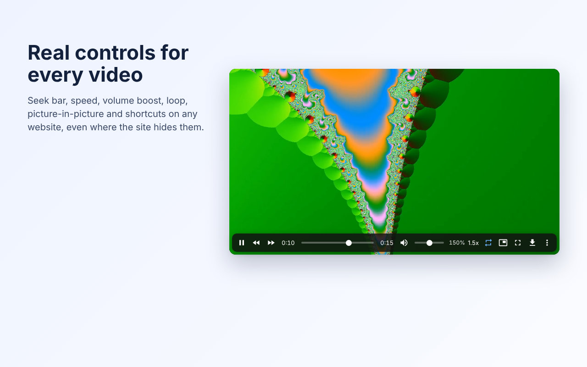
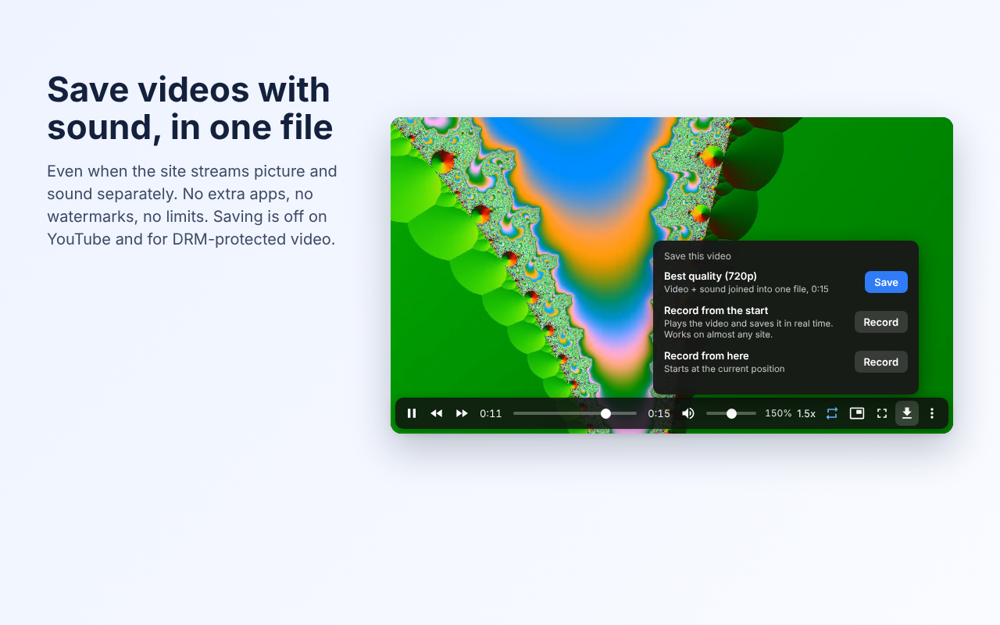

# VidFix: Video Controls & Downloader for Any Site

A Chrome extension (Manifest V3) that gives every web video real controls, even on sites that hide them, and saves videos with sound in one file.



## Why

Many sites strip the controls from their desktop video player. Facebook now publishes every video as a Reel with almost no controls, and Instagram, Reddit and X have similar gaps. Before building VidFix I read user reviews of existing video extensions. The common complaints were:

- no seek bar, volume or speed control on social media sites
- speed resetting to 1x after pause, and not remembered per site
- extensions slowing down pages that have no video at all
- shortcuts firing while typing, or breaking with Caps Lock
- downloaders that cannot save `blob:` streams, return dozens of unlabeled fragments, give video without sound, or need a companion app and add watermarks

VidFix is built to fix each of these.

## Features

**Control bar on any video**: play/pause, seek, time and remaining time, mute, volume up to 600% (Web Audio gain), speed 0.25x to 16x, loop, A-B repeat, frame step, picture-in-picture, fullscreen, screenshot, record and download. Appears when the mouse is over a video, even through click-blocking overlays.

**Keyboard shortcuts**: K play/pause, J/L seek, S/D speed, R reset, M mute, -/= volume, F fullscreen, P PiP, `,`/`.` frame step, O loop, B A-B repeat, G screenshot, H hide bar. Uses `KeyboardEvent.code` (layout and Caps Lock safe), only acts while the mouse is over a video, never inside text fields. All keys can be changed.

**Remembers**: speed and volume per site; keeps the chosen speed when a player resets it. Options for starting videos with sound and blocking autoplay. One-click off switch per site.

**Saving videos**
| Source | How VidFix saves it |
|---|---|
| Direct file (`<video src>`) | Chrome download manager |
| Split DASH video + audio (Facebook, Instagram) | Downloads both full files and joins them into one MP4 in the browser, no re-encoding |
| HLS `.m3u8` (X, Reddit, news sites) | Downloads all segments; separate audio renditions are merged in |
| Anything else (non-DRM) | Real-time recording with `captureStream()` + `MediaRecorder` |

Blocked by design: YouTube (Chrome Web Store policy), DRM-protected media (EME), encrypted HLS, live camera feeds in video calls.



## How it works

- **Closed shadow DOM UI** appended outside the site's player, so the page cannot style or break it, and it never causes the black-screen issues seen when extensions inject into the player.
- **Works under strict CSP / Trusted Types** (facebook.com blocks bookmarklets this way); content scripts run in an isolated world and build all UI with DOM APIs.
- **Hover detection by geometry**, not event targets, so overlays on top of the video don't matter. Videos inside shadow DOM (Reddit's player) are found with `elementsFromPoint` only when the element under the mouse has a shadow root, so ordinary pages pay nothing.
- **Stream discovery without the `webRequest` permission**: a `PerformanceObserver` on the page's own Resource Timing list notes `.m3u8`, `.mpd`, ranged (`bytestart`/`byteend`) and file URLs. Nothing leaves the tab.
- **In-browser MP4 muxer** (`src/mp4.js`): parses ISO-BMFF boxes, copies the video and audio `trak`s into a new `moov`, renumbers track IDs in `tkhd`/`trex`/`tfhd`, rebases `base_data_offset` when present, drops `sidx`/`styp`/`mfra`, and interleaves `moof`+`mdat` fragments by decode time.
- **Matching**: candidate streams are matched to the video on screen by duration (from `efg` metadata, `sidx`, `mehd` or the playlist), so the user sees the right file first instead of a list of fragments.
- **Volume boost safety**: Web Audio is only used on same-origin, `blob:` or CORS media; for cross-origin media it refuses with a message instead of silently muting the video.

## Install (developer mode)

1. Download or clone this repo.
2. Chrome: `chrome://extensions`, turn on **Developer mode**, click **Load unpacked**, select the `extension` folder.

To build the store package: `./build.sh` (creates `vidfix-extension.zip`).

## Tests

`tests/` is a local lab that copies how real sites deliver video: a Trusted Types page with a click-eating overlay, a Facebook-style MSE player with split fragmented-MP4 streams, X-style HLS with a separate audio rendition, HLS with TS segments, a shadow-DOM player, an iframe embed, a player that resets speed, a page with no video, and a mocked YouTube page.

```bash
cd tests
./setup.sh   # needs ffmpeg and Node.js; generates test media, installs Playwright
./run.sh     # 34 browser checks with the extension loaded
```

Downloads are checked with `ffprobe` (frame counts for both video and audio tracks).

## Project structure

```
extension/
  manifest.json
  src/netwatch.js    stream discovery (document_start)
  src/shared.js      settings, site rules, helpers
  src/mp4.js         ISO-BMFF parser and video+audio muxer
  src/hls.js         HLS playlist parser and downloader
  src/sources.js     ranks the ways to save a given video
  src/content.js     control bar, shortcuts, memory, boost, record, screenshot
  src/background.js  downloads and tab capture
  pages/             toolbar popup and settings page
store/               Chrome Web Store listing text and images
tests/               test lab and Playwright tests
privacy.html         privacy policy (served by GitHub Pages)
```

## Privacy

No servers, accounts, analytics or ads. Settings stay in the browser. See [privacy.html](privacy.html).

Only save videos you own or have permission to download.

## Credits

Built by Mac Awad. Control bar icons are Material Icons (Apache License 2.0).
